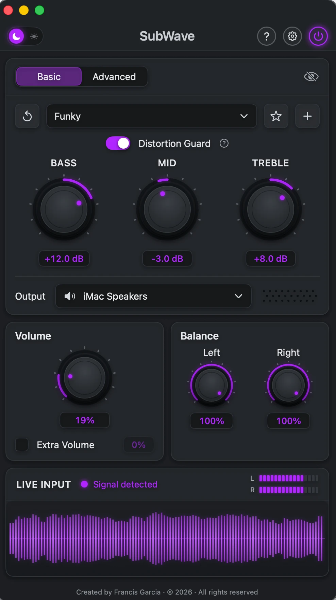
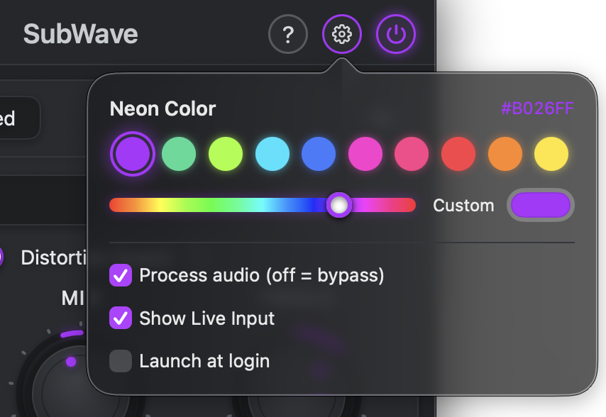

# SubWave
After trying several audio apps, I created SubWave to make customizing my Mac’s sound simple. It combines volume boost, left/right balance, and equalizer controls in one clean interface—letting you fine-tune your audio, save your favorite settings, and play through your preferred output.

<p align="center">
  
  &nbsp;&nbsp;
  
</p>

## Download

**[Download SubWave for Mac](https://github.com/frankzua-dev/SubWave/releases/latest/download/SubWave-1.0.0.zip)**

Requires macOS 14.4 (Sonoma) or later. Runs on both Apple chip (M1 and later) and Intel Macs.

## Install

1. Open the downloaded `SubWave-1.0.0.zip` to unzip it (Safari may already have done this).
2. Drag **SubWave** into your **Applications** folder.
3. Open SubWave. The first time, macOS will warn that it can't check the app for malicious software, because SubWave isn't registered with Apple. To open it anyway:
   - **macOS 15 (Sequoia) and later:** click **Done**, then go to **System Settings → Privacy & Security**, scroll down and click **Open Anyway** next to the SubWave message. Confirm with your password.
   - **macOS 14 (Sonoma):** right-click (or Control-click) SubWave in Applications, choose **Open**, then click **Open**.

   You only need to do this once.
4. When asked, allow SubWave to **record system audio**. SubWave needs this to process your Mac's sound; it never records or saves anything.

## Using SubWave

- **Funky** is the default sound. Pick **Flat** to hear your audio unchanged, or switch to **Advanced** for a 10-band equalizer.
- Turn the **Volume** knob, or check **Extra Volume** to go past 100%.
- Use the **Balance** knobs to set the left and right levels.
- Click ★ to save your current sound as a favorite.
- **Distortion Guard** keeps loud, bass-heavy sound from crackling. Click its **?** to learn more.
- The **power button** (top right) turns all processing on or off.
- SubWave also lives in the menu bar. Closing the window or quitting SubWave returns your Mac's sound to normal.

## Build from source

With Xcode installed:

```bash
scripts/build.sh      # builds build/SubWave.app
scripts/install.sh    # copies it to /Applications
scripts/package.sh    # zips it for a release
```

---

Created by Francis Garcia · © 2026 · All rights reserved.
